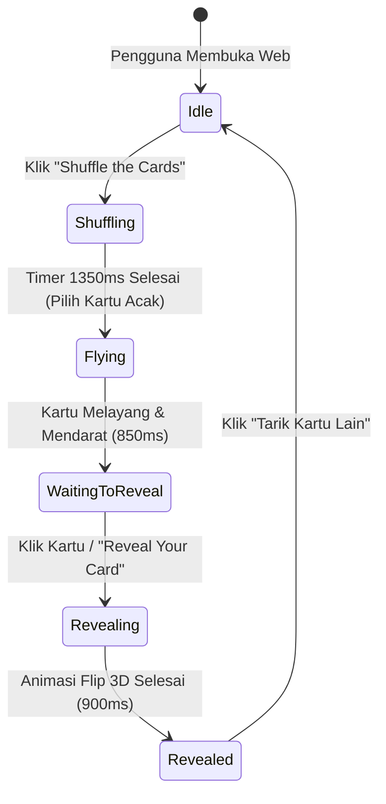

# DESAIN DAN ARSITEKTUR SISTEM: ARCANA — THE TAROT EXPERIENCE

Dokumen ini mendokumentasikan secara menyeluruh arsitektur teknis, desain antarmuka (UI/UX), sistem gerak (motion design), sistem interpretasi, dan pemeliharaan untuk **Arcana — The Tarot Experience**.

---

## 1. Ringkasan Eksekutif

- **Nama Aplikasi:** Arcana — The Tarot Experience
- **Tagline:** *"Discover the story written in your cards."*
- **Tujuan:** Menyediakan pengalaman spiritual modern melalui web interaktif gacha kartu tarot dengan animasi 3D, atmosfer gelap celestial, serta sistem pembacaan mendalam 7 dimensi kehidupan dalam Bahasa Indonesia.
- **Karakteristik Utama:**
  - 100% Client-side tanpa ketergantungan API berbayar atau backend server.
  - 78 kartu tarot Rider-Waite-Smith lengkap (22 Major Arcana + 56 Minor Arcana).
  - 546 interpretasi tarot bespoke dalam Bahasa Indonesia (78 kartu × 7 dimensi kehidupan: Percintaan, Pekerjaan, Karier, Keuangan, Pengembangan Diri, Keluarga & Pertemanan, Spiritual).
  - Animasi CSS 3D Transforms dengan perspective dan depth realism.
  - Sound synthesis via Web Audio API (default muted, bebas lisensi, zero-latency).
  - Card Library dengan filter pencarian dan Riwayat Pembacaan tersimpan di `localStorage`.

---

## 2. Arsitektur Frontend dan Struktur Folder

Aplikasi dibangun menggunakan **React 18**, **TypeScript**, dan **Vite** dengan pembagian tanggung jawab modul yang tegas:

```
Arcana — The Tarot Experience/
├── card/                         # Aset master kartu tarot asli (78 kartu + Card Back)
├── public/
│   └── assets/
│       └── tarot/
│           ├── back-card.jpg     # Tekstur belakang kartu resolusi tinggi
│           ├── back-card.png     # Fallback format PNG
│           ├── symbol.svg        # Segel mistis astrologi Arcana
│           └── cards/            # 78 gambar kartu tarot (.jpg)
├── scripts/
│   └── audit-tarot-assets.ts     # Skrip otomasi audit aset disk vs dataset TypeScript
├── src/
│   ├── components/
│   │   ├── hero/                 # HeroSection (Atmosphere & CTA)
│   │   ├── history/              # ReadingHistory (Daftar pembacaan & hapus)
│   │   ├── layout/               # Navbar & Footer
│   │   ├── library/              # CardLibrary & CardDetailModal
│   │   ├── reading/              # ReadingCategorySelector & ReadingResult
│   │   ├── tarot/                # TarotCard, TarotDeck, TarotGachaSection
│   │   └── ui/                   # Button, Modal, StarField
│   ├── data/
│   │   ├── readings/             # Data modular interpretasi per Arcana & Suit
│   │   │   ├── majorArcana.ts
│   │   │   ├── wands.ts
│   │   │   ├── cups.ts
│   │   │   ├── swords.ts
│   │   │   └── pentacles.ts
│   │   ├── tarotCards.ts         # Registri 78 kartu tarot (metadata, slug, keywords)
│   │   ├── tarotCategories.ts    # 7 Kategori pembacaan tarot
│   │   └── tarotReadings.ts      # Penggabung master dataset & getter
│   ├── hooks/
│   │   ├── useReadingHistory.ts  # State history tersinkronisasi localStorage
│   │   ├── useReducedMotion.ts   # Deteksi preferensi aksesibilitas gerakan
│   │   └── useTarotGacha.ts      # State machine siklus hidup pengundian kartu
│   ├── styles/
│   │   ├── animations.css        # Keyframes celestial, float, aura pulse
│   │   ├── globals.css           # Reset CSS, base typography & scrollbar
│   │   └── variables.css         # Token warna, typography, radius, shadow
│   ├── types/
│   │   └── tarot.ts              # TypeScript interfaces & domain types
│   ├── utils/
│   │   ├── randomCard.ts         # Algoritma penarikan acak merata & anti-duplikasi
│   │   ├── sound.ts              # Web Audio API Sound Synthesizer
│   │   └── storage.ts            # Wrapper localStorage aman
│   ├── App.tsx                   # Root orchestrator komponen
│   ├── main.tsx                  # Vite entrypoint
│   └── vite-env.d.ts             # CSS Modules & Vite types
├── DESAIN.md                     # Dokumentasi arsitektur dan sistem
├── index.html                    # Single page HTML shell dengan Google Fonts
├── package.json                  # Dependensi dan build scripts
├── tsconfig.json                 # Konfigurasi compiler TypeScript
└── vite.config.ts                # Konfigurasi Vite bundler
```

---

## 3. Konsep dan Identitas Visual

### Palet Warna (CSS Custom Properties)
Tema visual mengusung *Dark Celestial Mysticism*:
- `--color-background: #080711`: Kedalaman ruang malam tanpa batas.
- `--color-background-secondary: #100D1D`: Lapisan sekunder untuk kontras bertingkat.
- `--color-surface: #171327`: Permukaan elemen altar kartu dan panel kaca.
- `--color-surface-hover: #211A38`: Respons visual interaktif.
- `--color-primary: #9B7BFF`: Ungu astral untuk sorotan mistis.
- `--color-primary-soft: #C5B5FF`: Varian halus untuk keterbacaan teks sekunder.
- `--color-gold: #D9B56D`: Emas astrologi kuno untuk bingkai kartu dan hierarki tinggi.
- `--color-gold-light: #F0D9A0`: Kilau bintang untuk aksen teks dan icon.
- `--color-text: #F5F0FF`: Putih mutiara untuk keterbacaan tajam.
- `--color-text-secondary: #B8B0CC`: Abu lavender untuk deskripsi isi.
- `--color-text-muted: #817991`: Keterangan hak cipta dan metadata kecil.
- `--color-border: rgba(217, 181, 109, 0.25)`: Garis batas halus bertatahkan emas.

### Tipografi
- **Heading / Judul:** `Cinzel`, serif klasik terinspirasi dari prasasti kuno Romawi dengan proporsi proporsional dan aura arketipe.
- **Body / Antarmuka:** `Plus Jakarta Sans`, sans-serif modern berdaya baca tinggi, bersih, dan seimbang pada seluruh resolusi layar.

---

## 4. State Machine Alur Interaksi Gacha

Proses penarikan kartu dikendalikan oleh *Finite State Machine* di [`src/hooks/useTarotGacha.ts`](file:///d:/E/SEMESTER%207/cobacoba/Arcana%20%E2%80%94%20The%20Tarot%20Experience/src/hooks/useTarotGacha.ts):



1. **`idle`:** Tumpukan kartu (TarotDeck) beristirahat di altar. Instruksi: *"Tarik napas perlahan, jernihkan pikiranmu, dan acak kartu tarot."*
2. **`shuffling`:** Efek suara gemerisik kartu berputar, tumpukan kartu bergetar dinamis dengan rotasi acak.
3. **`flying`:** Satu kartu terpilih terlempar keluar dari tumpukan dalam lintasan parabola ke tengah altar utama dengan efek suara whoosh lembut.
4. **`waiting-to-reveal`:** Kartu mendarat tertutup dengan cahaya aura emas berdenyut (*celestial pulse*). Tombol *"Reveal Your Card"* aktif.
5. **`revealing`:** Kartu berputar 180° pada sumbu Y menggunakan `transform-style: preserve-3d`. Dentang lonceng celestial berbunyi bersama partikel starlight.
6. **`revealed`:** Gambar kartu depan terbuka penuh. Bagian interpretasi muncul di bawah altar tanpa mereset posisi kartu.

---

## 5. Sistem Aset Gambar & Validasi Otomatis

- Semua gambar kartu disimpan di [`public/assets/tarot/cards/`](file:///d:/E/SEMESTER%207/cobacoba/Arcana%20%E2%80%94%20The%20Tarot%20Experience/public/assets/tarot/cards/).
- Gambar sisi belakang kartu disimpan di `public/assets/tarot/back-card.jpg` dengan fallback ke `back-card.png`.
- Aspek rasio kartu tarot standar dipertahankan tanpa distorsi menggunakan properti CSS:
  ```css
  .cardImage {
    width: 100%;
    height: 100%;
    object-fit: contain;
  }
  ```
- **Fallback Toleran Kegagalan:** Jika salah satu berkas gambar gagal dimuat, kartu merender kartu fallback elegan dengan simbol arketipe, nama kartu, dan jenis arcana tanpa menyebabkan crash pada aplikasi.
- **Suite Audit Otomatis:** Dilengkapi skrip verifikasi [`scripts/audit-tarot-assets.ts`](file:///d:/E/SEMESTER%207/cobacoba/Arcana%20%E2%80%94%20The%20Tarot%20Experience/scripts/audit-tarot-assets.ts) yang mengonfirmasi kecocokan 78 berkas disk dengan dataset TypeScript.

---

## 6. Struktur Data Interpretasi Tarot

Setiap kartu tarot memiliki dataset lengkap di [`src/data/tarotReadings.ts`](file:///d:/E/SEMESTER%207/cobacoba/Arcana%20%E2%80%94%20The%20Tarot%20Experience/src/data/tarotReadings.ts). 
Setiap kartu memuat:
1. **Metadata:** ID, Nama, Nomor/Rank, Suit, Kata Kunci Posisi Tegak (Upright), Kata Kunci Posisi Terbalik (Reversed), dan Narasi Deskriptif.
2. **7 Kategori Pembacaan:**
   - **Percintaan (Love):** Makna dinamika asmara, saran emosional, dan pertanyaan refleksi batin.
   - **Pekerjaan (Work):** Situasi kerja harian, tantangan operasional, dan saran tim.
   - **Karier (Career):** Visi jangka panjang, momentum promosi/perubahan jalur hidup.
   - **Keuangan (Finance):** Manajemen risiko, investasi, dan arus kas.
   - **Pengembangan Diri (Self-Growth):** Transformasi mental, kebiasaan, dan pelepasan beban.
   - **Keluarga & Pertemanan (Relationships):** Komunikasi, batas emosional, dan ikatan sosial.
   - **Spiritual (Spirituality):** Sinkronisitas, intuisi, dan kedamaian spiritual.

---

## 7. Sistem Audio Tanpa Ketergantungan Eksternal (Web Audio API)

Sistem suara dirancang menggunakan Web Audio API murni di [`src/utils/sound.ts`](file:///d:/E/SEMESTER%207/cobacoba/Arcana%20%E2%80%94%20The%20Tarot%20Experience/src/utils/sound.ts):
- **Default:** Non-aktif (Muted). Tidak mengganggu pengguna yang menyukai keheningan.
- **Ambient Drone:** Akord D-minor mistis frekuensi rendah (73.4Hz, 110Hz, 146.8Hz, 185Hz) dengan filter low-pass dan modulasi volume lembut.
- **Shuffle SFX:** Pembangkit *white noise* berfilter modulasi band-pass yang mereplikasi gemerisik pergeseran kertas kartu tebal.
- **Fly Whoosh:** Osilator gelombang sinus menurun dengan filter penyapu frekuensi.
- **Reveal Chime:** Resonansi nada tinggi frekuensi ganda (528Hz Love Frequency & 792Hz) dengan decay eksponensial.

---

## 8. Manajemen Penyimpanan Lokal (`localStorage`)

Semua preferensi dan riwayat pembacaan disimpan rapi pada browser pengguna:
1. `arcana_audio_muted`: Status mute suara (boolean).
2. `arcana_allow_reversed`: Preferensi pengaktifan kartu terbalik (boolean).
3. `arcana_tarot_reading_history`: Array riwayat pembacaan tarot hingga 50 entri terbaru, memuat snapshot kartu, posisi, kategori yang dipilih, ringkasan interpretasi, dan timestamp.

---

## 9. Aksesibilitas dan Responsivitas

- **Keyboard Navigation:** Kartu dan deck dapat dioperasikan menggunakan tombol `Enter` dan `Spasi`.
- **Aria Attributes:** `role="button"`, `aria-label`, `aria-live="polite"` untuk pembaca layar (screen readers).
- **Reduced Motion:** Mendukung preferensi sistem `prefers-reduced-motion` untuk menonaktifkan lompatan kartu dan partikel yang berlebihan.
- **Mobile Friendly:** Rasio kartu menyesuaikan ukuran layar ponsel tanpa memotong detail kartu atau tombol navigasi.

---

## 10. Panduan Menambah Kartu Tarot Baru

Untuk menambahkan kartu baru di masa depan:
1. Simpan berkas gambar di `public/assets/tarot/cards/<Nama Kartu>.jpg`.
2. Buka [`src/data/tarotCards.ts`](file:///d:/E/SEMESTER%207/cobacoba/Arcana%20%E2%80%94%20The%20Tarot%20Experience/src/data/tarotCards.ts) dan tambahkan objek baru ke `TAROT_CARDS`.
3. Buka folder [`src/data/readings/`](file:///d:/E/SEMESTER%207/cobacoba/Arcana%20%E2%80%94%20The%20Tarot%20Experience/src/data/readings/) sesuai suit/arcana, lalu tambahkan 7 interpretasi kategorinya.
4. Jalankan `npx tsx scripts/audit-tarot-assets.ts` di terminal untuk memastikan 100% data terintegrasi tanpa galat.
5. Jalankan `npm run build` untuk memverifikasi build produksi.
